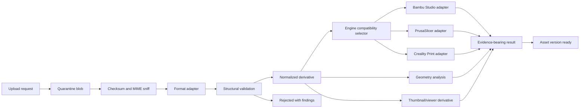

# Processing pipeline

## Pipeline stages

## Responsibilities

1. The request layer authenticates the actor, enforces coarse quotas, creates an asset/version record, and streams to transient quarantine storage.
2. The quarantine worker computes a checksum, detects type from content, rejects forbidden containers/references, and records the original media reference.
3. A format adapter parses within resource limits and emits a normalized representation or structured findings.
4. Validation checks topology, numeric ranges, dimensions, unit policy, object count, and configured limits. It does not “repair” silently; repairs create a named derivative with before/after evidence.
5. The compatibility selector discovers only approved engine installations/images, evaluates printer/material/process/profile compatibility, and applies the ordered product defaults: Bambu Studio, PrusaSlicer, then Creality Print for Ender/Creality compatibility.
6. The selector records every attempted engine, reason for rejection/failure, exit code, stdout/stderr references, and fallback transition. It never changes printer, material, process, nozzle, or profile silently.
7. Analysis workers perform geometric estimation and optionally call a selected slicer adapter. Each result states `Geometric`, `SlicerGenerated`, or `ActualProduction` provenance.
8. Derivative workers create thumbnails and viewer-safe files. Viewer derivatives are never the source of manufacturing output unless explicitly linked to a validated source.
9. A coordinator advances durable state and retries idempotently. Failed artifacts remain inspectable until retention cleanup.

## Engine adapter boundary

`IModelAnalysisService` remains the public analysis boundary. A subordinate engine-provider/adapter layer should expose descriptors and capabilities such as engine family, version, supported OS/image, supported input/output formats, printer families/models, material/process profile requirements, display/GPU requirements, and reproducibility limitations. Exact interface names are deferred to Stage 06.

Selection order is a policy default, not an unconditional executable chain. A candidate is eligible only when its explicit compatibility matrix matches the manufacturer/model, firmware capabilities, material, process, profile checksums, and deployment policy. A missing or incompatible primary engine may select an eligible secondary engine; a failed run may retry or fall back only under recorded policy. If no compatible engine exists, return a preliminary geometric result or a blocked analysis state.

## `IModelAnalysisService` evidence contract

The port should accept an immutable asset-version reference, material/printer/profile identifiers, and cancellation/limits. It returns an analysis result containing:

- Engine family, adapter version, engine version, OS/worker image, and attempt/fallback chain.
- Manufacturer/model, firmware capability reference, printer-profile version/checksum, filament-profile version/checksum, and process-profile version/checksum.
- Effective slicing parameters, source checksum, artifact checksums, units, precision, metrics, warnings, errors, exit code, start/end time, and duration.
- Estimated print time and per-material consumption, explicitly marked as slicer-generated rather than physical measurement.

## Estimates versus measurements

| Class | Example | Customer-facing wording |
| --- | --- | --- |
| Geometric estimate | Volume × density, nominal extrusion assumptions | “Preliminary geometric estimate” |
| Slicer-generated estimate | Time/material from a pinned Bambu Studio, PrusaSlicer, or Creality Print run | “Generated by [engine/version] with [profile checksums]” |
| Actual production | Scale/spool movement/operator record | “Recorded production measurement” |

Results from different engines must not be presented as equivalent without identifying their provenance and parameter snapshots. A heuristic cannot be presented as a precise slicer result.

## Runtime-specific deployment

The architecture does not require all engines to run in one process or container. Bambu Studio may require a virtual display or a runtime-specific worker because official issue evidence reports display initialization failures in headless Linux/AppImage scenarios. Creality Print has official Linux build instructions but also reported CLI crashes. PrusaSlicer remains the secondary worker candidate. Each worker must use an allowlisted installation/image and pinned presets.

## Failure and retry semantics

Workers use an idempotency key based on source checksum, adapter/engine version, profile checksums, and parameter snapshot. A retry may reuse verified immutable artifacts. Partial blobs are quarantined and cleaned by retention work; database state records the failure reason, attempt count, engine diagnostics, and fallback decision.
