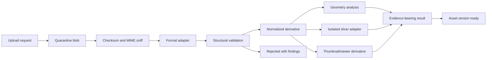

# Processing pipeline

## Pipeline stages

## Responsibilities

1. The request layer authenticates the actor, enforces coarse quotas, creates an asset/version record, and streams to transient quarantine storage.
2. The quarantine worker computes a checksum, detects type from content, rejects forbidden containers/references, and records the original media reference.
3. A format adapter parses within resource limits and emits a normalized representation or structured findings.
4. Validation checks topology, numeric ranges, dimensions, unit policy, object count, and configured limits. It does not “repair” silently; repairs create a named derivative with before/after evidence.
5. Analysis workers perform geometric estimation and optionally call a slicer adapter. Each result states `Geometric`, `SlicerGenerated`, or `ActualProduction` provenance.
6. Derivative workers create thumbnails and viewer-safe files. Viewer derivatives are never the source of manufacturing output unless explicitly linked to a validated source.
7. A coordinator advances durable state and retries idempotently. Failed artifacts remain inspectable until retention cleanup.

## `IModelAnalysisService` boundary

The port should accept an immutable asset-version reference, material/printer/profile identifiers, and cancellation/limits. It returns an analysis result with method, engine, engine version, input checksums, profile checksum, units, metrics, warnings, and confidence. Implementations include a deterministic geometry analyzer and engine-specific PrusaSlicer/OrcaSlicer adapters. A slicer adapter must not be allowed to execute arbitrary user-provided commands or binaries.

## Estimates versus measurements

| Class | Example | Customer-facing wording |
| --- | --- | --- |
| Geometric estimate | Volume × density, nominal extrusion assumptions | “Preliminary geometric estimate” |
| Slicer-generated estimate | Time/material from a pinned engine/profile | “Generated by PrusaSlicer X with profile Y” |
| Actual production | Scale/spool movement/operator record | “Recorded production measurement” |

The UI and quote model must preserve this distinction. A heuristic cannot be presented as a precise slicer result.

## Slicer evaluation

PrusaSlicer and OrcaSlicer are viable candidates because both are open-source slicer projects with CLI/headless workflows, but their AGPL licensing, bundled profiles, native dependencies, platform support, process isolation, and redistribution obligations require legal/deployment review. The adapter must pin engine version and profiles, use a restricted worker/container, capture stdout/stderr as diagnostics, enforce timeout and output quotas, and discard executable output on failure. It must never execute uploaded G-code.

## Failure and retry semantics

Workers use an idempotency key based on source checksum, adapter/engine version, profile checksum, and parameter snapshot. A retry may reuse verified immutable artifacts. Partial blobs are quarantined and cleaned by retention work; database state records the failure reason and attempt count.
